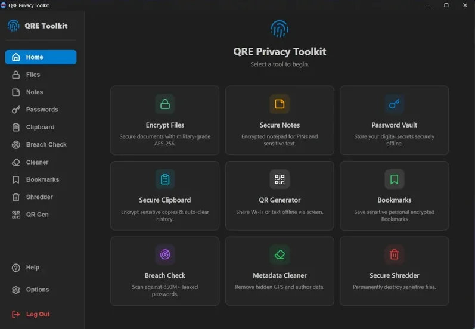

# QRE Privacy Toolkit

**The Local-First Swiss Army Knife for Digital Privacy.**

[](https://github.com/powergr/qre-privacy-toolkit/actions/workflows/build.yml)


QRE Privacy Toolkit is a secure, cross-platform application designed to handle your sensitive data without relying on the cloud. It runs natively on **Windows, macOS, Linux, and Android**.

**[📥 Download the Latest Release](https://github.com/powergr/qre-privacy-toolkit/releases)**

[](https://github.com/sponsors/powergr)

---



---

## 🛠️ The 12-Tool Suite (v2.9.0)

QRE Privacy Toolkit combines 12 essential privacy tools into one mathematically secure, memory-safe application:

### **1. 🔐 File Encryption**

Secure any file, such as photos, tax documents or 50GB video backups, using military-grade **AES-256-GCM**.

- **Unlimited Size:** Powered by a custom **Rust Streaming Engine**, you can encrypt files of any size without exhausting your RAM.
- **Smart Compression:** Automatically compresses documents while skipping already-compressed media files to save CPU cycles.
- **Cross-Platform:** Lock a file on your PC, unlock it on your Android phone.
- **Time-lock Feature:** The app refuses to open a time-locked file before the date you chose. It checks the time with internet time servers, and offline it never accepts a time lower than the highest one it has seen. This is enforced by the app, not by the encryption itself, so it guards against mistakes and impulse, not against someone who has your master password and edits the file. The details are in the file format document.
- **Open file format:** The layout of locked files, vault files and the keychain, the key chain, and what a file reveals without the key are written down in [FILE_FORMAT.md](FILE_FORMAT.md).

### **2. 🔑 Password Vault & Offline 2FA**

A secure, offline, zero-knowledge database for your logins.

- **Offline Authenticator (TOTP):** Generate live 6-digit 2FA codes directly inside your vault. No need for cloud-synced authenticator apps on your phone.
- **Generators:** Built-in strong password generator and local strength meter.

### **3. 📝 Secure Notes**

An encrypted notepad for sensitive text that isn't just a password. Store recovery seeds, Wi-Fi codes, or private journals safely at rest.

### **4. 🔖 Private Bookmarks**

Save your sensitive links (Bank logins, Medical portals, Crypto exchanges) in an encrypted vault, completely hidden from browser syncing and forensic tools.

### **5. 📋 Secure Clipboard**

Grabs text from your clipboard, encrypts it into a secure history, and **wipes** the OS clipboard immediately. Auto-clears entries after a customizable TTL.

### **6. 🧹 Metadata Cleaner & Steganography Scan**

A dual-purpose media privacy suite:

- **Meta Cleaner:** Scrub hidden GPS coordinates, camera/device models, and author data from Images (JPG/PNG/WebP/TIFF), PDFs, Office Docs, ZIP archives, Audio (MP3/FLAC/OGG), Video (MP4/MOV), and RAW camera formats. RAW formats (CR2/NEF/ARW/DNG) are analysis-only: cleaning is disabled to protect irreplaceable originals. Embedded images (cover art, pasted photos) are scrubbed recursively too, not just the outer file.
- **Steganography Detector:** Two complementary checks run on an image's decoded pixel data. A direct plaintext-recovery pass tries to read a hidden message straight out of each color channel's Least Significant Bits. A statistical pass flags a channel or region whose LSB entropy is an outlier relative to the rest of the image. This catches encrypted or compressed payloads that don't look like readable text.

### **7. 🕵️‍♂️ Local Secret Scanner & Breach Check**

Detect data leaks before they happen, and check if you've already been compromised.

- **Local Scanner:** Rapidly scans unencrypted `.txt`, `.csv`, and `.env` files on your hard drive to find exposed API keys, plaintext passwords, and crypto seed phrases.
- **HIBP API:** Checks if your password has appeared in known data leaks using **k-Anonymity**. We send only the first 5 characters of the hash to the internet.

### **8. ✅ Integrity Checker**

Verify that files you download (like crypto wallets, Linux ISOs, or installers) haven't been tampered with by hackers. Calculates SHA-256, SHA-1, and MD5 simultaneously.

### **9. 🗑️ Secure Shredder (Desktop)**

When you delete a file normally, the data remains on your disk. The Shredder physically overwrites your files with random noise (up to DoD Standard 3-Pass) before deleting them. Includes free-space wiping for HDDs and TRIM commands for SSDs.

### **10. 🔳 Secure QR Generator**

Share sensitive data (Wi-Fi passwords, Crypto addresses) with mobile devices completely offline. Data stays air-gapped on your screen.

### **11. 🧹 System & Registry Clean (Desktop)**

Remove temporary files, browser caches (Chrome, Edge, Brave), Windows Temp, and developer build artifacts (npm, cargo) to free up space. Safely scans and removes orphaned Windows Registry keys.

### **12. 🔎 File Analyzer**

Detects malicious files hiding behind fake extensions (e.g., `salary.pdf.exe`). Analyzes file headers (Magic Numbers) to determine the 'true' file type, ignoring the extension.

---

## 🛡️ Security Architecture

- **Memory Zeroization:** Cryptographic keys and plaintext payloads are actively scrubbed from your system's RAM (`0x00`) the exact moment they are no longer needed, defeating cold-boot attacks and RAM-scrapers.
- **Key Derivation:** Argon2id (Resistant to GPU brute-force attacks).
- **Hybrid Paranoid Mode:** Mitigates theoretical hardware RNG backdoors by XOR-mixing your physical mouse/touch timing jitter directly into the OS's cryptographic seed.
- **Panic Button:** `Ctrl+Shift+Q` instantly kills the app and wipes memory (Desktop).
- **Auto-Lock:** Sessions timeout automatically after inactivity.
- **File format:** See [FILE_FORMAT.md](FILE_FORMAT.md) for how locked files are built and what is stored in the clear.

---

## 💾 Portable USB Vaults

Transform any standard USB flash drive into a highly secure, cross-platform encrypted vault. No hardware encryption chips required.

- **True Portability:** Initialize a USB drive on your PC, unplug it, and securely unlock your files on any Windows, macOS, or Linux machine running QRE.
- **Multi-Vault Architecture:** QRE’s Rust backend functions as a dynamic Key Manager, securely holding multiple active `MasterKeys` in isolated memory environments simultaneously.
- **Ghost-File Protection (NAND Defense):** Because flash memory hardware uses wear-leveling algorithms that leave deleted plaintext data forensically recoverable, QRE enforces a safe "Encrypt locally, copy securely" workflow, warning you before you encrypt directly on a USB.
- **Sudden Ejection Watcher:** If a malicious actor (or clumsy user) physically yanks the unlocked USB drive out of the machine, a dedicated Rust background thread instantly detects the hardware removal and zeroes the Master Key from RAM.
- **Evil-Maid Verification:** During initialization, a unique Vault UUID is generated. Every time you unlock the drive on a new computer, the UUID is displayed, allowing you to verify out-of-band that an attacker hasn't stealthily swapped your USB's keychain file.

---

## New in v2.9.0

- **New:** The Home screen was rebuilt as one screen. All twelve tools are in view at once with no scrolling, even in a small laptop window. The tools are grouped as Protect, Inspect, Clean up and Create, each with its own color. Every tile is the same size, the block is centered in the window, and the tiles grow with the window height, so a large or full-screen window is filled instead of leaving empty space. A Protection panel shows whether your keychain is backed up, with a Back up now button. A short list shows the tools you opened since you unlocked the app. That list is kept in memory only and is cleared when the app locks.
- **New:** A jump bar opens with Ctrl+K (Cmd+K on a Mac) anywhere, or with the button on the Home screen. Type a few letters and press Enter to open a tool or run an action such as Lock now, Back up keychain or Change theme. It searches names only. It never looks inside your passwords or notes.
- **New:** The sidebar is grouped to match the Home screen. The Home button sits next to the collapse button at the top, and the tool buttons share the height of the sidebar equally, so the whole menu fits without scrolling. The sidebar can shrink to icons with the collapse button or Ctrl+B, and the choice is remembered.
- **New:** A status bar above every screen on computers. It shows that the vault is unlocked, a live countdown to the automatic lock, whether the keychain is backed up, and a Lock button.
- **Changed:** Success messages such as Backup saved, Copied, Hashing completed or Cleanup completed now appear as a short notice that closes itself. Before, each one was a dialog that needed a click. Errors and the unencrypted-export warnings still use dialogs, because they need to be read.
- **Changed:** Buttons and text fields have softer corners, hover states and a clear keyboard focus ring. On touch screens they are at least 44 pixels tall. Colors in both the dark and light themes were checked for readable contrast.
- **Changed:** The interface now runs on shared parts: buttons, fields, switches, dialogs, side drawers, notices and progress cards. This keeps every screen consistent and is the base for the next redesign steps.
- **Changed:** Every tool now follows the same flow. A start screen with a drop zone comes first, then a progress card while it works, then the result. If something goes wrong, a shared message box explains it and has a close button. This covers Integrity Check, File Analyzer, Privacy Check, System Cleaner, Metadata Cleaner, Shredder and QR Generator.
- **New:** Integrity Check shows the SHA-256 hash first. SHA-1 and MD5 are old and weak, so they sit behind a button. They open by themselves when the hash you paste to compare matches one of them.
- **New:** File Analyzer can show all findings, only dangers, or only warnings. Each row now says Danger or Warning in words, so the risk is not shown by color or an icon alone.
- **New:** Privacy Check counts the exposed secrets by category. Each finding has a Locate button that opens its folder. The start screen no longer shows behind the Scan Cancelled message.
- **New:** System Cleaner tells you how much space the selected items will free, right next to the Clean button. Its notices about warnings, administrator rights, developer caches and privacy items use the shared message box.
- **Changed:** The QR Generator tabs share the width of the card equally, and the PNG and SVG buttons show their save keys.
- **Changed:** Adding or editing a password or a bookmark now opens in a panel that slides in from the right, so the list stays visible behind it. Cancel and Save sit together at the bottom of the panel, and Escape or a click outside closes it. Errors such as a missing title or a failed save show inside the panel.
- **Changed:** The bookmark editor warns you in a message box if the URL is already stored. The question before clearing the clipboard history is now a red dialog that Escape also closes.
- **Changed:** Passwords, Notes, Bookmarks and Clipboard share one empty screen with a short hint on what to do first. A failed text import in Notes now shows the themed error dialog instead of a plain system alert.
- **New:** The Files screen has a Places list on the left with Home, Desktop, Documents and Downloads. The folder you are in is marked. The list is hidden in narrow windows and on phones.
- **New:** When you select files, a bar under the list names the selection and offers Details, Delete and Clear selection. Details opens a panel with the type, size, date and location of the item. For several items it shows the totals.
- **Changed:** Every part of the path in the address bar is now a button that works from the keyboard, and Ctrl+L (Cmd+L on a Mac) lets you type a path. The drop hint now says that dropped files are encrypted with your current settings.
- **New:** On a phone the sidebar is replaced by a bottom bar with five places: Home, Files, Passwords, Tools and More. Tools lists every other tool in its group. More opens Settings, which now has Help Topics and About as well. Switching the window width between phone and computer sizes switches the layout.
- **Changed:** On a phone, the side panels for editing a password or a bookmark rise from the bottom edge as sheets. Pull a sheet down by its top edge to close it. The Details panel in Files also becomes a sheet above the bottom bar. Messages that pop up at the bottom now appear above the bar instead of behind it.
- **Changed:** Settings is grouped into Appearance, Security and App. Each row has a short line that says what it does.
- **Changed:** On touch screens the chips, tabs, close buttons, color dots and the Files rows are at least 44 pixels in size, so they are easy to hit with a finger.
- **Changed:** The sign-in screens keep clear of notches and gesture bars, and scroll when the keyboard takes space. Forgot Password and Restore from Backup are now real buttons with a large touch area. The old grey texts have a readable color. The sign-in and setup screens say that everything stays on the device.
- **Changed:** If the bookmarks vault or the clipboard history cannot be opened, the screen now says what failed, shows the reason, and offers a Try again button. Before, it was a dead end.
- **Changed:** Plain wording about the time-lock. The Time-Lock dialog and the Help manual now say that the lock is kept by the app, not by the encryption. It guards against mistakes and impulse, not against someone with your master password and the right tools, and the date can be read without the password.
- **New:** Upgrade Older Locked Files. In the options menu of the Files screen, the app finds the locked files in the open folder (and its sub folders) that an older version made, and rewrites them in the current format, which hides their file names. Each file is decrypted and sealed again in memory, so nothing is written to the disk in the clear. The new file is checked from start to finish before it replaces the old one, and if anything goes wrong the old file is left as it was. Files that are still time-locked are skipped until the lock ends, files locked with a key file need that key file, and USB vault files need their vault unlocked.
- **New:** A format badge in the Details panel. Select a locked file and open Details to see whether it is in the current format or an older one (with its version number), and with several files selected it counts the older ones. An older file also gets a short note on why it matters and how to fix it.
- **New:** Upgrade Format in the right-click menu. For a locked file that an older version made, the menu now offers to rewrite just that file in the current format, with the same checks as the folder upgrade. The entry appears only for files that need it. If several files are selected, the old ones among them are upgraded.
- **New:** Upgrade Older Files When Unlocking, a setting in the options menu that is off until you turn it on. When it is on, a file that an older version made is also rewritten in the current format right after you unlock it. Only files that unlocked are touched, so a wrong key file or a running time-lock never starts an upgrade. Problems from the unlock and the upgrade are shown together.
- **New:** A notice about the recovery code. Changing your password, or using the recovery code to get back in, does not replace the code, so anyone who has seen it can still open your vault. The app now says so at those moments and offers a new code in one click. The old code stops working at once.
- **Fixed:** Safer file names when unlocking. Characters that reverse the direction of text (such as U+202E, which can make a file look like another type) are replaced with an underscore. On Windows, trailing dots and spaces are dropped, and names such as `CON ` or `AUX .txt`, which Windows treats as devices, are refused.
- **Fixed:** A damaged or hostile chunk can no longer expand to more than 1 MiB when it is decompressed, so it cannot fill the memory. This applies to every format.
- **Changed:** A damaged file header is no longer reported as a wrong password. In format 8 the key check is separate from the rest of the header, so a wrong password and a damaged header give different messages. Damage to the key check's own bytes still looks like a wrong password.
- **Fixed:** A tampered `keychain.json` can no longer make the app try to allocate gigabytes of memory. Key derivation settings above the largest values the app itself writes (1 GiB, 16 passes, 16 lanes) are refused at once. This applies to the desktop keychain and to portable USB vaults.
- **Changed:** FILE_FORMAT.md is now written for outside reviewers. It has the threat model, the known limits, a log of review findings and their decisions, the full error table, two sample files with a known key, and the source of an independent decoder that reads them.
- **New:** File format 8, which the app now writes for every new locked file. It hides the file name and the plaintext hash inside the encrypted data. It also authenticates the whole header, including the time-lock date, so editing the date in a hex editor no longer opens the file. Format 8 has no time-lock ratchet: it never changed whether a file opens, and removing it means a locked file is never rewritten when an unlock is refused. Older versions of the app cannot open format 8 files, so update every device that shares locked files. Files made by older versions can still be opened and keep their visible file names until you lock them again. The layout is in [FILE_FORMAT.md](FILE_FORMAT.md).
- **New:** Verify After Locking. By default, the app now opens each new locked file once, the same way unlocking does, before it says the lock is done. If the file is damaged or cut short, it is removed and the message says that your original is untouched. It is a switch in the options menu of the Files screen, and it also applies to time-locks. The check never applies the time-lock and does not change the file.
- **Fixed:** Locking and unlocking are safer when something goes wrong. A locked file now appears under its real name only when it is complete and on disk. An unlocked file appears only after every part and the whole-file hash have been checked. Before, an interrupted or damaged run could leave a cut-off `.qre` file or a half-decrypted file next to your own files.
- **Fixed:** Vault files (passwords, notes, bookmarks and clipboard history) and a restored keychain are now saved through a temporary file that replaces the old one in a single step. Before, a crash or a full disk while saving could leave a vault empty.
- **Fixed:** A damaged or edited locked file can no longer make the app create a file outside the folder you chose for unlocking.
- **Fixed:** Locking a folder that cannot be read completely no longer leaves a partial zip copy of it behind, and a single file of 4 GB or more inside a folder no longer makes the lock fail.
- **Fixed:** The compression option called Store (None) did not store anything. It is now called Fastest (Minimal) and uses the fastest setting of the compressor.
- **Fixed:** On Android, the clock, signal and battery icons at the top of the screen were white on the white background in the light theme, when the phone itself was in dark mode. The app now sets the icon color from its own theme, and follows the phone when the theme is System.
- **Fixed:** The auto-lock now follows the real clock. Before, it relied on a timer that a phone pauses in the background and a computer stops during sleep, so the app could stay unlocked for hours. When you come back to the app, it locks at once if the time is up, or shows the warning with the true seconds left.
- **Fixed:** In Passwords and Secure Notes the top bar no longer scrolls sideways on a phone. It stacks into rows: title, search, then the buttons, with Add New and New Note first. On narrow computer windows it wraps.
- **Fixed:** On phones and tablets without a mouse, keyboard hints such as Ctrl+K on the Home jump button and the save keys in the QR Generator are no longer shown. The buttons themselves still work.
- **Fixed:** On Windows, emptying the Recycle Bin, flushing DNS and clearing the clipboard in System Cleaner no longer flash a black command window.
- **Fixed:** If emptying the Recycle Bin fails, System Cleaner now reports the failure with its reason. Before, it always said the bin was emptied.
- **Fixed:** The Home screen was not centered in a full-screen window.
- **New:** You can cancel a long lock. Press Esc or click Cancel on the progress card while locking, unlocking, upgrading or time-locking. The app stops within a moment, removes the file it was writing and leaves your original alone. Files that were already finished stay finished, and the message says how many. Before, a 15 GB folder could not be stopped. Copying, moving and deleting still cannot be stopped.
- **New:** Copy and paste now work with Explorer. Ctrl+C, Ctrl+X and Ctrl+V (and the right-click menu) put the selected files on the Windows clipboard, so they can be pasted in Explorer. Files copied in Explorer can be pasted into the open folder in QRE, and a cut there is moved. On other systems and on Android, copy and paste still work inside the app only.
- **Changed:** Vault files now use file format 8. The passwords, notes, bookmarks and clipboard files are saved the same way as a locked file. The name inside and the hash of the content are sealed, the whole header is authenticated, and a vault file copied over another one is refused. Every save is opened again before it replaces the old file, so a bad save can never destroy a vault.
- **Changed:** Vaults from earlier versions are moved to the new format the first time they are opened. The content is carried over byte for byte. If the move fails, the old file stays and the vault opens as before. After the move, apps older than this version cannot open that vault file. Copy the four vault files first if you may go back.
- **Changed:** FILE_FORMAT.md now explains how random numbers are made: the system seed, the optional mouse input, the ChaCha20 generator, the order of the values, and what is and is not wiped from memory.
- **Testing:** The project now has 842 Rust tests and over 2,400 frontend tests, and every screen and dialog is covered. Each push to GitHub runs a fast subset on Windows, Linux and macOS, and a full run happens weekly.

## New in v2.8.5

- **Fixed:** The Escape key did nothing in the Notes, Vault and Bookmarks editors. It now closes the top dialog first in every screen, so a confirmation closes before the editor behind it.
- **New:** Keyboard shortcuts in the tools. Ctrl+N adds an entry, bookmark or note, and Ctrl+F jumps to the search box. Ctrl+S saves the open editor. Ctrl+O picks files or a folder in the Integrity Checker, File Analyzer, Privacy Check, Metadata Cleaner and Shredder. In the QR Generator, Ctrl+S saves a PNG and Ctrl+Shift+S saves an SVG. Shortcuts pause while a dialog is open. The full list is in Help under Keyboard Shortcuts.
- **Changed:** Privacy Check, Integrity Checker, System Cleaner, Metadata Cleaner, Shredder, File Analyzer and the QR Generator now share one layout. The title sits at the top, tabs follow, and each start screen is centered below. Before, every page was arranged a little differently.
- **Fixed:** Linux: Privacy Check refused any folder with a system name inside its path, such as `~/dev` or `~/variables`. It now blocks only real system folders. The free-space wipe also judged RAM drives by loose text matching. It now picks the mount that really holds the folder. The bookmark import now finds Brave and Edge as well as Chrome and Chromium.
- **Fixed:** macOS: files in the temporary folder were refused as system files by the Shredder and by file locking, because a Mac keeps that folder under `/var`. Only your own temporary folder is now allowed. The protected-folder check for locking also compared loose text, so a folder such as `/variables` counted as system, and the macOS system folders were not covered. Both problems are now fixed.
- **Fixed:** Linux and macOS: in the file list, a link to a folder showed up as a file and could not be opened, and a link to a file showed the length of its path instead of the file size. Links are now followed. Privacy Check also now refuses the macOS system folders.
- **Fixed:** Android: the File Analyzer smart scan listed every file twice, because `/sdcard` and `/storage/emulated/0` are the same storage. Each real folder is now scanned once.

Also see: Time-Lock Encryption, added in v2.7.6. Read more in the [Time-lock blog post](https://powergr.github.io/privacy_toolkit/blog-timelock-encryption.html).

---

## 🚀 Getting Started & Building

```bash
# 1. Install Dependencies
npm install

# 2. Run in Dev Mode
npm run tauri dev

# 3. Build for Release
npm run tauri build
```

## ⚠️ Important Security Notice

QRE Privacy Toolkit follows a strict **Zero-Knowledge** architecture. If you lose your **Master Password** AND your **Recovery Code**, your data is mathematically inaccessible. There is no "Password Reset" button because there is no server. **Backup your `keychain.json` file safely.**

---

## ✅ Test Coverage

QRE Privacy Toolkit maintains rigorous, automated cryptographic and UI testing to guarantee safety across updates.

**Rust Backend (`cargo test`):**

- 836 tests passed from 836 total (6 more, which use the real Windows clipboard, run only on request). Covers memory wiping, file routing, steganography detection, and Zip-Bomb prevention. Also covers AES-GCM streaming integrity and metadata-cleaner round-trips across every supported file format. Includes concurrency and injection regression tests for the Shredder and keychain. The command layer now has tests for login lockout, session wiping, vault file encryption, clipboard expiry, TOTP codes, paste, and time-lock checks. Cancelling a scan, hash, or clean is tested too, including starting a new run right after a cancel. The Linux, macOS and Android paths are tested as well: protected folders, RAM-backed drives, TRIM results, browser bookmark locations, and the Android storage folders.

**Automated checks (GitHub Actions):** every push and pull request runs the type-check, the whole frontend suite (about ten seconds) and the Rust tests except two slow file-system scans. The Rust tests run on Windows, Linux and macOS. Android logic is tested through plain functions on those machines, and its screens by the frontend tests. A full run of everything happens weekly and can be started by hand from the Actions tab.

**Frontend (`npm test`):**

- 2433 tests passed from 2433 total (Jest suite covering UI state, ReDoS-safe regex heuristic parsing, and password strength algorithm boundaries). Tests run in a fixed US Eastern time zone, so date handling is checked the same way on every machine. Also covers the login, setup, and recovery flows, file browsing, key file handling, and portable USB vaults. Nearly every screen is tested end to end, including the Vault, Notes, Bookmarks, Clipboard, Integrity Checker, QR, Privacy Check, and File Analyzer, with their failed-save and cancelled-scan cases. The dialogs are tested too, including the password health check, time-lock picker, update flows, and the entropy collector. The Files screen is covered as well, including locking and unlocking, USB drive warnings, drag and drop, cut, copy and paste, deleting, keyboard shortcuts, time-lock badges, and the right-click menu. The main app shell is tested too: sign-in screens, tab switching, keychain backup, password changes, USB vault dialogs, and what happens to open dialogs when a session ends. The sign-in screen and the password field (show or hide, passphrase generator, strength meter) are tested as well. The Notes editor is covered in depth: sorting, the markdown preview, the formatting buttons, find and replace, tags, auto-save, and import and export. The password vault is covered the same way, including live 2FA codes, the editor, and CSV import and export. The shredder is tested too, including cancelling, progress, the free-space wipe and TRIM cards, and their safeguards. The metadata cleaner and steganography scanner are covered as well, including cancelling, comparisons and scan results. The system and registry cleaner is tested as well, including its size limits, backup requirement, cancelling and administrator relaunch. The Escape key (topmost dialog closes first), every keyboard shortcut, and the shared tool page layout are covered too. So are the shared interface parts: buttons, fields, the segmented switch, dialogs, drawers, toasts, and the progress card. The grouped sidebar, the jump bar, the status bar, the auto-lock countdown and the new Home screen are tested as well.

---

**License:** MIT | **Copyright:** © 2026 Project QRE Privacy Toolkit

---
