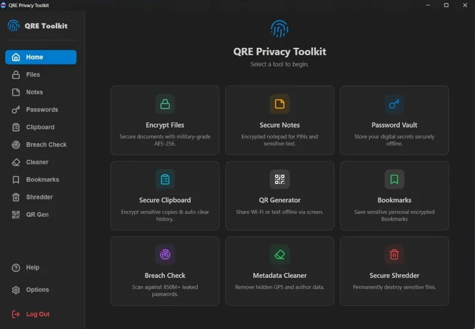

# QRE Privacy Toolkit

**The Local-First Swiss Army Knife for Digital Privacy.**

[](https://github.com/powergr/qre-privacy-toolkit/actions/workflows/build.yml)


QRE Privacy Toolkit is a secure, cross-platform application designed to handle your sensitive data without relying on the cloud. It runs natively on **Windows, macOS, Linux, and Android**.

**[📥 Download the Latest Release](https://github.com/powergr/qre-privacy-toolkit/releases)**

[](https://github.com/sponsors/powergr)

---



---

## 🛠️ The 12-Tool Suite (v2.8.6)

QRE Privacy Toolkit combines 12 essential privacy tools into one mathematically secure, memory-safe application:

### **1. 🔐 File Encryption**

Secure any file, such as photos, tax documents or 50GB video backups, using military-grade **AES-256-GCM**.

- **Unlimited Size:** Powered by a custom **Rust Streaming Engine**, you can encrypt files of any size without exhausting your RAM.
- **Smart Compression:** Automatically compresses documents while skipping already-compressed media files to save CPU cycles.
- **Cross-Platform:** Lock a file on your PC, unlock it on your Android phone.
- **Time-lock Feature:** Time-Lock Encryption function implemented. Checking the correct time with NTP and ratchet time check.

### **2. 🔑 Password Vault & Offline 2FA**

A secure, offline, zero-knowledge database for your logins.

- **Offline Authenticator (TOTP):** Generate live 6-digit 2FA codes directly inside your vault. No need for cloud-synced authenticator apps on your phone.
- **Generators:** Built-in strong password generator and local strength meter.

### **3. 📝 Secure Notes**

An encrypted notepad for sensitive text that isn't just a password. Store recovery seeds, Wi-Fi codes, or private journals safely at rest.

### **4. 🔖 Private Bookmarks**

Save your sensitive links (Bank logins, Medical portals, Crypto exchanges) in an encrypted vault, completely hidden from browser syncing and forensic tools.

### **5. 📋 Secure Clipboard**

Grabs text from your clipboard, encrypts it into a secure history, and **wipes** the OS clipboard immediately. Auto-clears entries after a customizable TTL.

### **6. 🧹 Metadata Cleaner & Steganography Scan**

A dual-purpose media privacy suite:

- **Meta Cleaner:** Scrub hidden GPS coordinates, camera/device models, and author data from Images (JPG/PNG/WebP/TIFF), PDFs, Office Docs, ZIP archives, Audio (MP3/FLAC/OGG), Video (MP4/MOV), and RAW camera formats. RAW formats (CR2/NEF/ARW/DNG) are analysis-only: cleaning is disabled to protect irreplaceable originals. Embedded images (cover art, pasted photos) are scrubbed recursively too, not just the outer file.
- **Steganography Detector:** Two complementary checks run on an image's decoded pixel data. A direct plaintext-recovery pass tries to read a hidden message straight out of each color channel's Least Significant Bits. A statistical pass flags a channel or region whose LSB entropy is an outlier relative to the rest of the image. This catches encrypted or compressed payloads that don't look like readable text.

### **7. 🕵️‍♂️ Local Secret Scanner & Breach Check**

Detect data leaks before they happen, and check if you've already been compromised.

- **Local Scanner:** Rapidly scans unencrypted `.txt`, `.csv`, and `.env` files on your hard drive to find exposed API keys, plaintext passwords, and crypto seed phrases.
- **HIBP API:** Checks if your password has appeared in known data leaks using **k-Anonymity**. We send only the first 5 characters of the hash to the internet.

### **8. ✅ Integrity Checker**

Verify that files you download (like crypto wallets, Linux ISOs, or installers) haven't been tampered with by hackers. Calculates SHA-256, SHA-1, and MD5 simultaneously.

### **9. 🗑️ Secure Shredder (Desktop)**

When you delete a file normally, the data remains on your disk. The Shredder physically overwrites your files with random noise (up to DoD Standard 3-Pass) before deleting them. Includes free-space wiping for HDDs and TRIM commands for SSDs.

### **10. 🔳 Secure QR Generator**

Share sensitive data (Wi-Fi passwords, Crypto addresses) with mobile devices completely offline. Data stays air-gapped on your screen.

### **11. 🧹 System & Registry Clean (Desktop)**

Remove temporary files, browser caches (Chrome, Edge, Brave), Windows Temp, and developer build artifacts (npm, cargo) to free up space. Safely scans and removes orphaned Windows Registry keys.

### **12. 🔎 File Analyzer**

Detects malicious files hiding behind fake extensions (e.g., `salary.pdf.exe`). Analyzes file headers (Magic Numbers) to determine the 'true' file type, ignoring the extension.

---

## 🛡️ Security Architecture

- **Memory Zeroization:** Cryptographic keys and plaintext payloads are actively scrubbed from your system's RAM (`0x00`) the exact moment they are no longer needed, defeating cold-boot attacks and RAM-scrapers.
- **Key Derivation:** Argon2id (Resistant to GPU brute-force attacks).
- **Hybrid Paranoid Mode:** Mitigates theoretical hardware RNG backdoors by XOR-mixing your physical mouse/touch timing jitter directly into the OS's cryptographic seed.
- **Panic Button:** `Ctrl+Shift+Q` instantly kills the app and wipes memory (Desktop).
- **Auto-Lock:** Sessions timeout automatically after inactivity.

---

## 💾 Portable USB Vaults

Transform any standard USB flash drive into a highly secure, cross-platform encrypted vault. No hardware encryption chips required.

- **True Portability:** Initialize a USB drive on your PC, unplug it, and securely unlock your files on any Windows, macOS, or Linux machine running QRE.
- **Multi-Vault Architecture:** QRE’s Rust backend functions as a dynamic Key Manager, securely holding multiple active `MasterKeys` in isolated memory environments simultaneously.
- **Ghost-File Protection (NAND Defense):** Because flash memory hardware uses wear-leveling algorithms that leave deleted plaintext data forensically recoverable, QRE enforces a safe "Encrypt locally, copy securely" workflow, warning you before you encrypt directly on a USB.
- **Sudden Ejection Watcher:** If a malicious actor (or clumsy user) physically yanks the unlocked USB drive out of the machine, a dedicated Rust background thread instantly detects the hardware removal and zeroes the Master Key from RAM.
- **Evil-Maid Verification:** During initialization, a unique Vault UUID is generated. Every time you unlock the drive on a new computer, the UUID is displayed, allowing you to verify out-of-band that an attacker hasn't stealthily swapped your USB's keychain file.

---

## New in v2.8.6

- **New:** The Home screen was rebuilt as one screen. All twelve tools are in view at once with no scrolling, even in a small laptop window. The tools are grouped as Protect, Inspect, Clean up and Create, each with its own color. Every tile is the same size, the block is centered in the window, and the tiles grow with the window height, so a large or full-screen window is filled instead of leaving empty space. A Protection panel shows whether your keychain is backed up, with a Back up now button. A short list shows the tools you opened since you unlocked the app. That list is kept in memory only and is cleared when the app locks.
- **New:** A jump bar opens with Ctrl+K (Cmd+K on a Mac) anywhere, or with the button on the Home screen. Type a few letters and press Enter to open a tool or run an action such as Lock now, Back up keychain or Change theme. It searches names only. It never looks inside your passwords or notes.
- **New:** The sidebar is grouped to match the Home screen. The Home button sits next to the collapse button at the top, and the tool buttons share the height of the sidebar equally, so the whole menu fits without scrolling. The sidebar can shrink to icons with the collapse button or Ctrl+B, and the choice is remembered.
- **New:** A status bar above every screen on computers. It shows that the vault is unlocked, a live countdown to the automatic lock, whether the keychain is backed up, and a Lock button.
- **Changed:** Success messages such as Backup saved, Copied, Hashing completed or Cleanup completed now appear as a short notice that closes itself. Before, each one was a dialog that needed a click. Errors and the unencrypted-export warnings still use dialogs, because they need to be read.
- **Changed:** Buttons and text fields have softer corners, hover states and a clear keyboard focus ring. On touch screens they are at least 44 pixels tall. Colors in both the dark and light themes were checked for readable contrast.
- **Changed:** The interface now runs on shared parts: buttons, fields, switches, dialogs, side drawers, notices and progress cards. This keeps every screen consistent and is the base for the next redesign steps.
- **Changed:** Every tool now follows the same flow. A start screen with a drop zone comes first, then a progress card while it works, then the result. If something goes wrong, a shared message box explains it and has a close button. This covers Integrity Check, File Analyzer, Privacy Check, System Cleaner, Metadata Cleaner, Shredder and QR Generator.
- **New:** Integrity Check shows the SHA-256 hash first. SHA-1 and MD5 are old and weak, so they sit behind a button. They open by themselves when the hash you paste to compare matches one of them.
- **New:** File Analyzer can show all findings, only dangers, or only warnings. Each row now says Danger or Warning in words, so the risk is not shown by color or an icon alone.
- **New:** Privacy Check counts the exposed secrets by category. Each finding has a Locate button that opens its folder. The start screen no longer shows behind the Scan Cancelled message.
- **New:** System Cleaner tells you how much space the selected items will free, right next to the Clean button. Its notices about warnings, administrator rights, developer caches and privacy items use the shared message box.
- **Changed:** The QR Generator tabs share the width of the card equally, and the PNG and SVG buttons show their save keys.
- **Fixed:** The Home screen was not centered in a full-screen window.
- **Testing:** The project now has 507 Rust tests and over 1,900 frontend tests, and every screen and dialog is covered. Each push to GitHub runs a fast subset on Windows, Linux and macOS, and a full run happens weekly.

## New in v2.8.5

- **Fixed:** The Escape key did nothing in the Notes, Vault and Bookmarks editors. It now closes the top dialog first in every screen, so a confirmation closes before the editor behind it.
- **New:** Keyboard shortcuts in the tools. Ctrl+N adds an entry, bookmark or note, and Ctrl+F jumps to the search box. Ctrl+S saves the open editor. Ctrl+O picks files or a folder in the Integrity Checker, File Analyzer, Privacy Check, Metadata Cleaner and Shredder. In the QR Generator, Ctrl+S saves a PNG and Ctrl+Shift+S saves an SVG. Shortcuts pause while a dialog is open. The full list is in Help under Keyboard Shortcuts.
- **Changed:** Privacy Check, Integrity Checker, System Cleaner, Metadata Cleaner, Shredder, File Analyzer and the QR Generator now share one layout. The title sits at the top, tabs follow, and each start screen is centered below. Before, every page was arranged a little differently.
- **Fixed:** Linux: Privacy Check refused any folder with a system name inside its path, such as `~/dev` or `~/variables`. It now blocks only real system folders. The free-space wipe also judged RAM drives by loose text matching. It now picks the mount that really holds the folder. The bookmark import now finds Brave and Edge as well as Chrome and Chromium.
- **Fixed:** macOS: files in the temporary folder were refused as system files by the Shredder and by file locking, because a Mac keeps that folder under `/var`. Only your own temporary folder is now allowed. The protected-folder check for locking also compared loose text, so a folder such as `/variables` counted as system, and the macOS system folders were not covered. Both problems are now fixed.
- **Fixed:** Linux and macOS: in the file list, a link to a folder showed up as a file and could not be opened, and a link to a file showed the length of its path instead of the file size. Links are now followed. Privacy Check also now refuses the macOS system folders.
- **Fixed:** Android: the File Analyzer smart scan listed every file twice, because `/sdcard` and `/storage/emulated/0` are the same storage. Each real folder is now scanned once.

Also see: Time-Lock Encryption, added in v2.7.6. Read more in the [Time-lock blog post](https://powergr.github.io/privacy_toolkit/blog-timelock-encryption.html).

---

## 🚀 Getting Started & Building

```bash
# 1. Install Dependencies
npm install

# 2. Run in Dev Mode
npm run tauri dev

# 3. Build for Release
npm run tauri build
```

## ⚠️ Important Security Notice

QRE Privacy Toolkit follows a strict **Zero-Knowledge** architecture. If you lose your **Master Password** AND your **Recovery Code**, your data is mathematically inaccessible. There is no "Password Reset" button because there is no server. **Backup your `keychain.json` file safely.**

---

## ✅ Test Coverage

QRE Privacy Toolkit maintains rigorous, automated cryptographic and UI testing to guarantee safety across updates.

**Rust Backend (`cargo test`):**

- 507 tests passed from 507 total. Covers memory wiping, file routing, steganography detection, and Zip-Bomb prevention. Also covers AES-GCM streaming integrity and metadata-cleaner round-trips across every supported file format. Includes concurrency and injection regression tests for the Shredder and keychain. The command layer now has tests for login lockout, session wiping, vault file encryption, clipboard expiry, TOTP codes, paste, and time-lock checks. Cancelling a scan, hash, or clean is tested too, including starting a new run right after a cancel. The Linux, macOS and Android paths are tested as well: protected folders, RAM-backed drives, TRIM results, browser bookmark locations, and the Android storage folders.

**Automated checks (GitHub Actions):** every push and pull request runs the type-check, the whole frontend suite (about ten seconds) and the Rust tests except two slow file-system scans. The Rust tests run on Windows, Linux and macOS. Android logic is tested through plain functions on those machines, and its screens by the frontend tests. A full run of everything happens weekly and can be started by hand from the Actions tab.

**Frontend (`npm test`):**

- 1862 tests passed from 1862 total (Jest suite covering UI state, ReDoS-safe regex heuristic parsing, and password strength algorithm boundaries). Tests run in a fixed US Eastern time zone, so date handling is checked the same way on every machine. Also covers the login, setup, and recovery flows, file browsing, key file handling, and portable USB vaults. Nearly every screen is tested end to end, including the Vault, Notes, Bookmarks, Clipboard, Integrity Checker, QR, Privacy Check, and File Analyzer, with their failed-save and cancelled-scan cases. The dialogs are tested too, including the password health check, time-lock picker, update flows, and the entropy collector. The Files screen is covered as well, including locking and unlocking, USB drive warnings, drag and drop, cut, copy and paste, deleting, keyboard shortcuts, time-lock badges, and the right-click menu. The main app shell is tested too: sign-in screens, tab switching, keychain backup, password changes, USB vault dialogs, and what happens to open dialogs when a session ends. The sign-in screen and the password field (show or hide, passphrase generator, strength meter) are tested as well. The Notes editor is covered in depth: sorting, the markdown preview, the formatting buttons, find and replace, tags, auto-save, and import and export. The password vault is covered the same way, including live 2FA codes, the editor, and CSV import and export. The shredder is tested too, including cancelling, progress, the free-space wipe and TRIM cards, and their safeguards. The metadata cleaner and steganography scanner are covered as well, including cancelling, comparisons and scan results. The system and registry cleaner is tested as well, including its size limits, backup requirement, cancelling and administrator relaunch. The Escape key (topmost dialog closes first), every keyboard shortcut, and the shared tool page layout are covered too. So are the shared interface parts: buttons, fields, the segmented switch, dialogs, drawers, toasts, and the progress card. The grouped sidebar, the jump bar, the status bar, the auto-lock countdown and the new Home screen are tested as well.

---

**License:** MIT | **Copyright:** © 2026 Project QRE Privacy Toolkit

---
